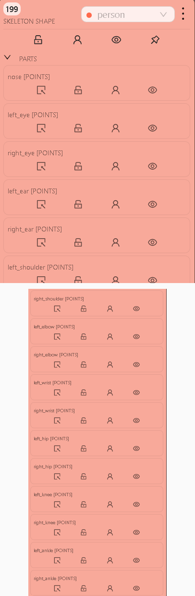
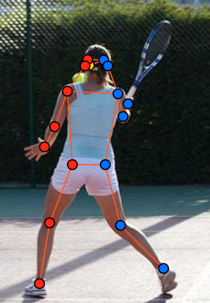
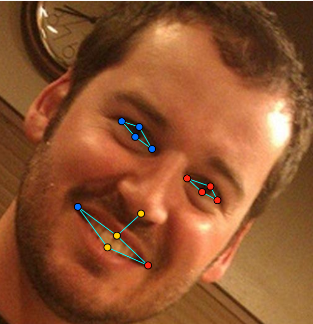
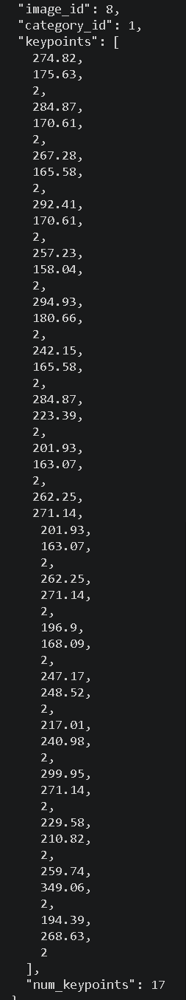

# Báo cáo cá nhân — TrieuHoangHieu

Đổi tên file theo quy tắc `MSSV_HoTen.md`. Ví dụ: `20241234_NguyenVanAn.md`.

Dữ liệu: 12 ảnh người COCO val2017 (Lin et al., 2014) và 8 ảnh chân dung Wikimedia Commons, chỉ dùng trong lớp.

## 0. Thông tin học viên

- Họ tên: Trieu Hoang Hieu
- MSSV: 202603294
- Email: 26ai.hieuth@vinuni.edu.vn
- Link repository: https://github.com/hieuwewe123/K5-L2B-TrieuHoangHieu-2A202603294-KeypointPose-Student
- Phiên bản CVAT: v2.74.1 (theo Docker image `cvat/server` và `cvat/ui`)
- Máy: Windows · RAM 7.6 GiB (theo `free -h` trong WSL) · chế độ CVAT: chưa xác định
- Bộ ảnh (`src/exports/assignment.json` do `lab.py setup` tạo): có
- Giờ bắt đầu: không nhớ
- Giờ kết thúc: không nhớ

## 1. Kiểm tra label (CP0)

| Label | Kiểu | Số điểm | Tên điểm đúng bảng của lab? | Đúng thứ tự? | Số cạnh |
|---|---|---:|---|---|---:|
| `person` | skeleton | 17 | Có | Có | 19 |
| `face` | skeleton | 13 | Có | Có | 13 |

Mẫu `person` dựng theo người quay mặt về camera (các điểm `left_*` nằm bên phải khung mẫu)? Có (theo schema của lab)

Cách đổi cờ `occluded` / `outside` cho **một điểm**: rê chuột lên đúng điểm rồi nhấn `Q` / `O` (hoặc chuột phải để mở menu điểm). Hướng dẫn lab ghi thao tác này đã thử trên CVAT 2.82; phiên bản máy này là 2.74.1 nên chưa xác minh độc lập trên đúng phiên bản.

## 2. Số lượng đã gán và thời gian (CP1, CP2)

| Nhóm ảnh | Số ảnh | Số skeleton đã gán | Số người dưới 60 px (không gán) | Số poster / gương / màn hình bỏ qua | Thời gian (phút) |
|---|---:|---:|---:|---:|---:|
| `easy` | 5 | 5 | Không nhớ | Không nhớ | Không rõ |
| `occluded` | 3 | 4 | Không nhớ | Không nhớ | Không rõ |
| `back` | 2 | 4 | Không nhớ | Không nhớ | Không rõ |
| `small` | 1 | 1 | Không nhớ | Không nhớ | Không rõ |
| `crowd` | 1 | 3 | Không nhớ | Không nhớ | Không rõ |
| `faces` | 8 | 8 | — | — | Không rõ |

- Tổng hiện tại: 17 skeleton người trên 12 ảnh; 8 skeleton mặt trên 8 ảnh (theo file export hiện có).

- Số ảnh người đã xong ở mốc phút 105: 10 / 10
- Thời gian thực tế (phút): CP1 không rõ · CP2 không rõ · CP3 không rõ
- Ảnh tốn thời gian nhất là ảnh nào, vì sao? Không nhớ.

## 3. Bảng ca khó (CP1, CP2)

Mỗi điểm bạn phân vân một dòng, nhất là phân vân giữa `v = 1` và `v = 0`, hoặc không chắc hướng người.

| Ảnh | Người / mặt | Điểm | Cờ đã chọn | Phân vân giữa | Lý do chọn |
|---|---|---|---:|---|---|
| `000000438099.jpg` | Người chính và đám đông phía sau | Các điểm bị laptop che / điểm cơ thể khó xác định | Theo nhãn đã kiểm tra | `v=1` hay `v=0` tùy mức độ có thể ước lượng | Cảnh đông người; người phía sau bị mờ và nhiều người đang ngồi nên dáng không đầy đủ. Nhân vật chính bị laptop che phía trước và đeo kính râm; học viên đã kiểm tra và không thấy lỗi. |
| `000000019754.jpg` | Người trượt ván | Một phần chân bị ván che | Theo nhãn đã kiểm tra | `v=1` nếu ước lượng chắc, `v=0` nếu không thể xác định | Người đang ở trên không do trượt ván; ván che một phần chân. Học viên đã kiểm tra và không thấy lỗi. |
| `000000359340.jpg` | Người ở xa | Các khớp ở phần cơ thể tràn khỏi ảnh | `v=0` cho điểm ngoài khung | `v=0` hay `v=1` ở phần bị cắt/che | Người ở xa bị cắt mất khoảng một nửa do tràn khỏi ảnh. Học viên đã kiểm tra và không thấy lỗi. |
| `000000467300.jpg` | Người đàn ông và người phụ nữ phía trước | Tay/chân người đàn ông; thân dưới cả hai | Theo nhãn đã kiểm tra | `v=1` nếu ước lượng chắc, `v=0` nếu không thể xác định | Người đàn ông bị người phụ nữ che một tay/chân; bàn che thân dưới cả hai. Học viên đã kiểm tra và không thấy lỗi. |
| `000000516902.jpg` | Người trong ảnh | Bàn chân | `v=0` cho điểm ngoài khung | Ngoài ảnh hay bị che | Ảnh bị cắt mất bàn chân. Học viên đã kiểm tra và không thấy lỗi. |
| `face_99874.jpg` | Mặt #1, các điểm mắt | 8 điểm quanh mắt | `v=1` | `v=2` nếu mắt nhìn thấy rõ | Ảnh đeo kính râm tối; sau khi kiểm tra, đặt `v=1` cho 8 điểm mắt, còn các điểm mũi/miệng giữ `v=2`. |
| `face_38721.jpg` | Mặt #1 | Điểm ở phía bị điện thoại che (nếu có) | Theo nhãn đã kiểm tra | `v=1` nếu ước lượng chắc, `v=0` nếu không thể xác định | Người trong ảnh đang cầm/nghe điện thoại; học viên đã kiểm tra và không thấy lỗi ở nhãn. |
| `face_85624.jpg` | Mặt #1 | Tai phía bị khuất | Theo nhãn đã kiểm tra | `v=1` nếu ước lượng chắc, `v=0` nếu không thể xác định | Mặt hơi nghiêng nên thiếu một bên tai nhìn thấy; học viên đã kiểm tra và không thấy lỗi ở nhãn. |
| | | | | | |

## 4. Bảng tự review (CP3)

Đi từ ảnh cuối về ảnh đầu. Bảng này có 6 ảnh người và 3 ảnh mặt; trong đó có ảnh thuộc nhóm `back` (`000000359340.jpg`) và `crowd` (`000000326480.jpg`). Ghi lỗi trước, sửa sau.

Mã lỗi dùng đúng một trong: `lr_swap`, `vis_flag`, `position`, `missing`, `extra`, `ok`.

| Ảnh | Người / mặt | Điểm | Mã lỗi | Ghi chú | Đã sửa? |
|---|---|---|---|---|---|
| `000000326480.jpg` | Người trong ảnh nhóm crowd | Skeletons đã gán | `ok` | Học viên đã kiểm tra ảnh và không thấy lỗi. | Không |
| `000000438099.jpg` | Người chính và đám đông phía sau | Skeleton đã gán | `ok` | Cảnh đông người; người phía sau mờ/ngồi, nhân vật chính bị laptop che và đeo kính râm. Học viên đã kiểm tra và không thấy lỗi ở nhãn đã gán. | Không |
| `000000359340.jpg` | Người ở xa | Phần cơ thể tràn khỏi khung | `ok` | Người bị cắt mất khoảng một nửa ở mép ảnh; học viên đã kiểm tra nhãn và không thấy lỗi. | Không |
| `000000516902.jpg` | Người trong ảnh | Bàn chân bị cắt khỏi ảnh | `ok` | Học viên đã kiểm tra các điểm bàn chân ngoài khung và không thấy lỗi. | Không |
| `000000467300.jpg` | Người đàn ông và người phụ nữ phía trước | Tay/chân và thân dưới bị che | `ok` | Người đàn ông bị người phụ nữ che một tay/chân; bàn che thân dưới cả hai. Học viên đã kiểm tra nhãn và không thấy lỗi. | Không |
| `000000019754.jpg` | Người trượt ván | Chân bị ván che một phần | `ok` | Người đang ở trên không do trượt ván; phần chân bị ván che. Học viên đã kiểm tra visibility/nhãn và không thấy lỗi. | Không |
| `face_38721.jpg` | Mặt #1 | Các điểm quanh vùng bị điện thoại che (nếu có) | `ok` | Người trong ảnh đang cầm/nghe điện thoại; học viên đã kiểm tra nhãn và không thấy lỗi. | Không |
| `face_99874.jpg` | Mặt #1 | 8 điểm mắt | `ok` | Đã sửa cờ trên CVAT: 8 điểm mắt là `v=1`, còn mũi/miệng là `v=2`; export mới xác nhận đúng. | Có |
| `face_85624.jpg` | Mặt #1 | Tai phía bị khuất | `ok` | Mặt hơi nghiêng nên một bên tai không nhìn thấy; học viên đã kiểm tra nhãn và không thấy lỗi. | Không |

Tổng hợp số lỗi theo mã (9 ảnh khác nhau đã ghi: 6 ảnh người và 3 ảnh mặt; có ảnh nhóm `back` và `crowd`):

| `lr_swap` | `vis_flag` | `position` | `missing` | `extra` | `ok` |
|---:|---:|---:|---:|---:|---:|
| 0 | 0 | 0 | 0 | 0 | 9 |

Điểm còn phân vân giữa `v = 1` và `v = 0` (ghi cả hai lựa chọn và lý do chọn):

`face_99874.jpg`: kính râm tối che mắt nên 8 điểm mắt được đặt `v=1`; mũi và miệng giữ `v=2`. Với bàn chân nằm ngoài khung ở `000000516902.jpg`, cờ phù hợp là `v=0`; học viên đã kiểm tra nhãn và không thấy lỗi.

## 5. Kiểm file xuất và kết quả tự kiểm (CP4)

Tự kiểm tay trong file JSON:

| File | Người / mặt kiểm (ảnh, thứ tự) | Số phần tử `keypoints` | Điểm `outside` ra `v = 0`, `occluded` ra `v = 1`? | `num_keypoints` khớp? |
|---|---|---:|---|---|
| `TrieuHoangHieu_persons.zip` | 000000019754.jpg, #1 | 51 | Định dạng hợp lệ; không có v=1 trong file nên chưa xác nhận được cờ occluded | Có |
| `TrieuHoangHieu_persons.zip` | 000000351176.jpg, #1 | 51 | Định dạng hợp lệ; không có v=1 trong file nên chưa xác nhận được cờ occluded | Có |
| `TrieuHoangHieu_faces.zip` | face_99874.jpg, #1 | 39 | 8 điểm mắt `v=1`, các điểm mũi/miệng `v=2` | Có |

Theo quy tắc COCO Keypoints của lab, CVAT ghi `occluded` thành `v = 1` và `outside` thành `v = 0`. File mặt mới có 8 điểm `v = 1` tại tám điểm mắt của `face_99874.jpg`, xác nhận cờ được xuất đúng. Có 49 điểm `v = 0` trong file người vẫn giữ tọa độ cũ theo ghi chú của validator; chuẩn COCO bỏ qua các tọa độ đó.

Hai job đã chuyển sang completed trên CVAT? Có (theo xác nhận của học viên).

Dán phần **TÓM TẮT** in ra từ `src/check_submission.py`:

```text
- File person: TrieuHoangHieu_persons.zip
  Số ảnh: 12 · số skeleton `person`: 17 · mỗi annotation 51 số
  Skeleton theo ảnh: 000000019754=1, 000000261732=1, 000000295358=1, 000000326480=3, 000000351176=2, 000000359340=2, 000000438099=1, 000000451084=1, 000000467300=1, 000000493741=1, 000000516902=2, 000000571665=1
  Cờ v: v=2 234 (81%) · v=1 0 (0%) · v=0 55 (19%)
  num_keypoints trung bình: 13.8
- File face: TrieuHoangHieu_faces.zip
  Số ảnh: 8 · số skeleton `face`: 8 · mỗi annotation 39 số
  Skeleton theo ảnh: face_137371=1, face_178208=1, face_261458=1, face_38721=1, face_449454=1, face_85624=1, face_92028=1, face_99874=1
  Cờ v: v=2 96 (92%) · v=1 8 (8%) · v=0 0 (0%)
  num_keypoints trung bình: 13.0
- Ghi chú: 49 điểm v = 0 vẫn mang tọa độ cũ (CVAT 2.x xuất như vậy; chuẩn COCO ghi 0, 0). Không phải lỗi: điểm v = 0 bị bỏ qua khi huấn luyện và khi chấm.
- Số [LỖI]: 0 · số [CẢNH BÁO]: 5
Kết quả: ĐẠT (đọc lại từng cảnh báo ở trên)
```

Các `[CẢNH BÁO]` được giữ nguyên; theo quyết định của học viên, không sửa thêm nhãn trên CVAT:

- `000000351176.jpg #1`: validator nghi ngờ hướng trái/phải toàn thân.
- `000000359340.jpg #1`: validator nghi ngờ hướng trái/phải toàn thân.
- `000000359340.jpg #2`: `left_wrist` v=2 ở tọa độ (427, 73), sát mép ảnh; skeleton cao 58 px.
- `000000571665.jpg #1`: validator phát hiện cặp tai có thể ngược phía so với các cặp còn lại.

Đây là cảnh báo heuristic, không phải kết luận đã xác nhận bằng đối chiếu thủ công. Các file xuất hiện tại vẫn giữ nguyên; không chỉnh JSON bằng tay.

## 6. Ảnh chụp màn hình

Đã thêm đủ bốn ảnh bằng chứng. Ảnh số 1 là hai phần chụp liên tiếp của danh sách label `person`, ghép theo thứ tự cuộn để hiển thị tên 17 điểm; ảnh số 4 cũng được ghép từ hai phần chụp liên tiếp của cùng đoạn JSON export.

1. Label `person` trong danh sách label, tên 17 keypoint:

   
   Ảnh ghép từ hai phần chụp liên tiếp của danh sách label. Nguồn ảnh: giao diện CVAT.

2. Một người quay lưng đã gán, cờ đã đặt:

   
   Nguồn ảnh: COCO val2017.

3. Một khuôn mặt đã gán 13 điểm, phóng to vùng mắt:

   
   Nguồn ảnh: Wikimedia Commons.

4. Một đoạn JSON xuất của một người:

   
   Annotation của `000000451084.jpg` trong file xuất COCO Keypoints; `num_keypoints` là 17. Ảnh chụp hai phần liên tiếp, ghép dọc để thấy toàn bộ mảng `keypoints`.

## 7. Tự đánh giá

1. Lỗi bạn mắc nhiều nhất hôm nay, và cách bạn sẽ tránh ở dự án thật:

   Lỗi thường gặp: đặt sai vị trí landmark khi ảnh nghiêng.

2. Một quy tắc bạn đề xuất thêm vào guideline (kèm ảnh ví dụ nếu có):

   Ảnh bị nghiêng hoặc che mặt thì không đoán vị trí điểm, chỉ đánh dấu khi nhìn thấy hoặc xác định được.

3. Nhãn của bạn đi vào model ở đâu? Chọn một lỗi bạn đã sửa và nói nó sẽ làm model học sai thế nào (heatmap, trọng số trong loss, hay bước lật ảnh):

   Chưa sửa lỗi nhãn cụ thể nào nên chưa có trải nghiệm thực tế về ảnh hưởng đến heatmap, loss hoặc lật ảnh.

## 8. Khó khăn và lỗi kỹ thuật

Chưa gặp lỗi kỹ thuật đáng kể; chủ yếu khó xác định vị trí landmark ở những ảnh khuôn mặt bị nghiêng hoặc che khuất.

## Bonus

Không thực hiện bonus B1, B2 hoặc B3.


## 9. Tài liệu tham khảo và công cụ AI đã dùng

- GitHub Copilot (AI chat): hỗ trợ đọc checklist, diễn giải kết quả `src/check_submission.py`, và diễn đạt/định dạng một số ghi chú ở mục ca khó và tự review dựa trên thông tin học viên cung cấp. Không dùng AI để sinh hoặc sửa tọa độ keypoint.
